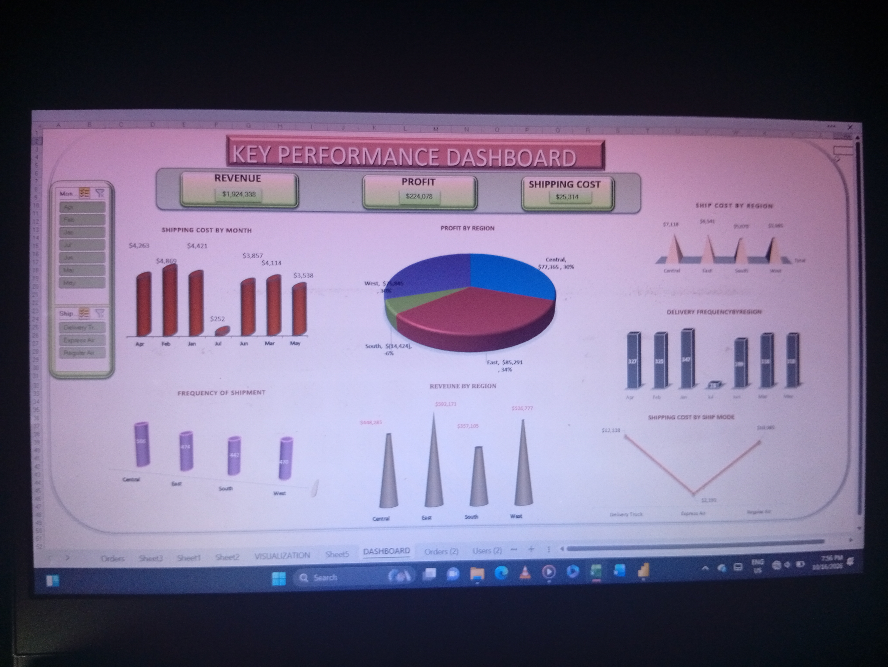

# us-superstore-excel-dashboard
## Interative Microsoft Excel dashboard analyzing US Superstore revenue, profit margins, and shipping logistics metrics across regions and fulfillment modes.
A comprehensive data analytics dashboard built to evaluate financial performance, profitability, and shipping logistics for a nationwide US retail enterprise. This interactive dashboard transforms raw retail transaction data into actionable business insights across revenue, regional distribution, and fulfillment efficiency.
## 

## 📌 Project Overview
Understanding the interplay between sales revenue, profit margins, and logistics costs is critical for optimizing operations. This project provides a 360-degree view of business operations by analyzing overall financial health while dissecting cost drivers—specifically shipping expenses—across regions and delivery modes.

## 🔑 Key Metrics & Dashboard Visualizations
The dashboard is structured into three primary operational pillars: Financial Overview, Regional Analytics, and Logistics & Fulfillment Breakdown.

**1. High-Level KPIs**
**Total Revenue:** Summary of overall gross sales generated.
**Total Profit:** Net earnings after product costs and overhead.
**Total Shipping Cost:** Aggregate freight and delivery expenditures.
**Frequency of Shipment:** Overall volume and count of fulfilled orders.

## 3. Regional Analysis ##
* Revenue by Region:* Geographic breakdown of sales performance to identify top-performing markets.
* Profit by Region:* Highlighting profitable vs. low-margin/loss-making geographic zones.
* Delivery Frequency by Region:* Mapping order demand distribution across different geographic territories.

## 4. Logistics & Temporal Trends ##
Shipping Cost by Month: Trend lines tracking seasonality, peak shipping periods, and cost fluctuations over time.
Shipping Cost by Ship Mode: Cost distribution across fulfillment methods (Standard Class, Second Class, First Class, Same Day) to evaluate shipping mode margins.

 Data Architecture & Workflow
[ Raw Superstore Dataset ]
           │
           ▼
[ Data Cleaning & Transformation ]
  • Handled missing values & adjusted data types
  • Created custom calculated measures (Margins, Order Counts)
           │
           ▼
[ Data Modeling & Visualizations ]
  • Built interactive charts & KPI cards
  • Established cross-filtering & slice-and-dice functionality

💡 Key Business Insights & Takeaways
Logistics Cost Optimization: Analyzing Shipping Cost by Ship Mode against Delivery Frequency highlights whether premium shipping options are disproportionately eroding profit margins.

Regional Margin Variance: Comparing Revenue by Region against Profit by Region identifies areas with high sales volume but sub-par profitability due to elevated freight costs or deep discounting.
Seasonal Demand Shifts: The Shipping Cost by Month timeline exposes freight expense spikes during high-volume peak quarters, aiding future operational budget planning.

🚀 How to View / Replicate
Clone the Repository:
git clone https://davecodes-ux.github.io/us-superstore-excel-dashboard/

Open Project File:
Open in Excel 2016 or newer version 
Explore Data: Interactively click through regional and fulfillment slicers to dynamically filter metrics.

📬 Contact & Connect
Portfolio / GitHub: davecodes-ux
Email: ugwuchinedu242@gmail.com
